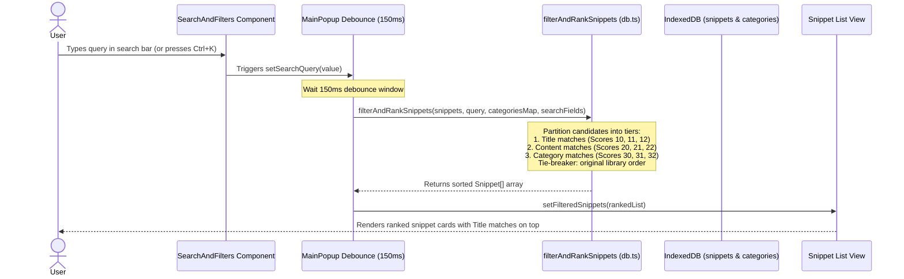
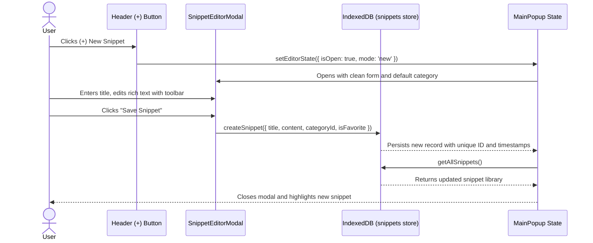
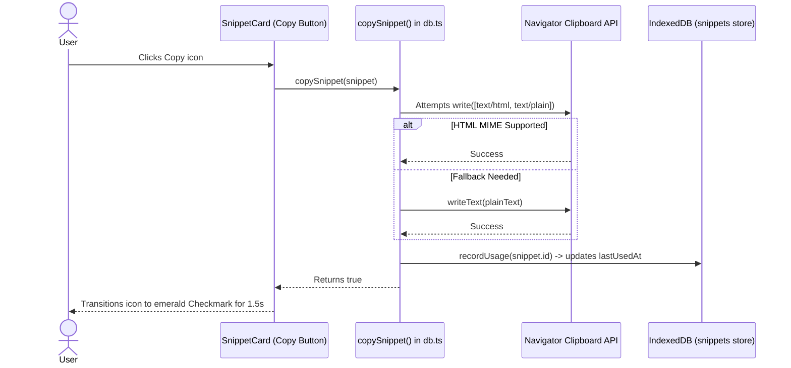
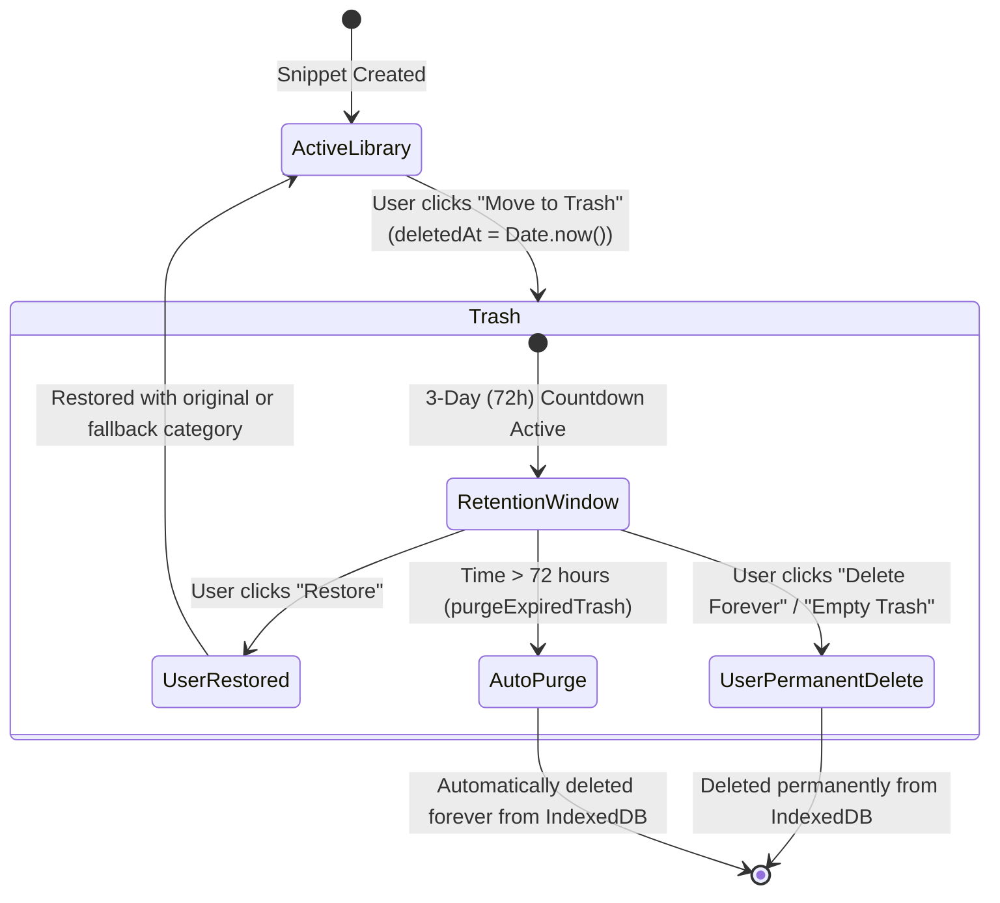
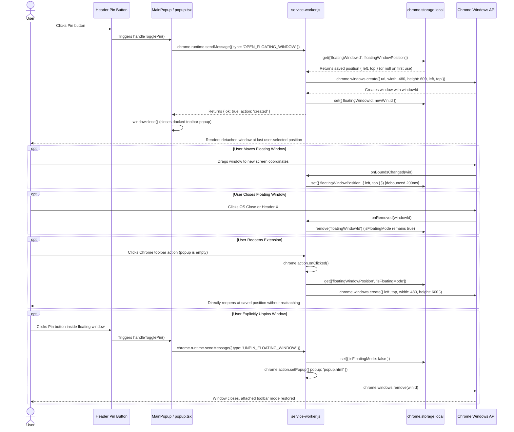
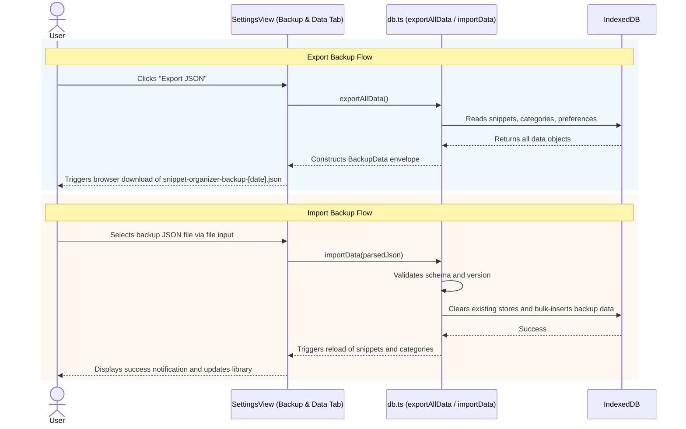

# Interaction Flows — Snippet Organizer

**Snapshot Date: 2026-10-14** `[SOURCE-VERIFIED]`

This document illustrates the primary user interaction flows, state transitions, and background events in Snippet Organizer using Mermaid sequence and state diagrams.

---

## 1. Search & Priority Ranking Flow

---

## 2. Snippet Creation, Editing & Persistence Flow

---

## 3. One-Click Copy & Usage Tracking Flow

---

## 4. Move to Trash, 3-Day Retention & Restore Flow

---

## 5. Docked to Floating Window Transition Flow

---

## 6. Backup JSON Export & Import Flow

