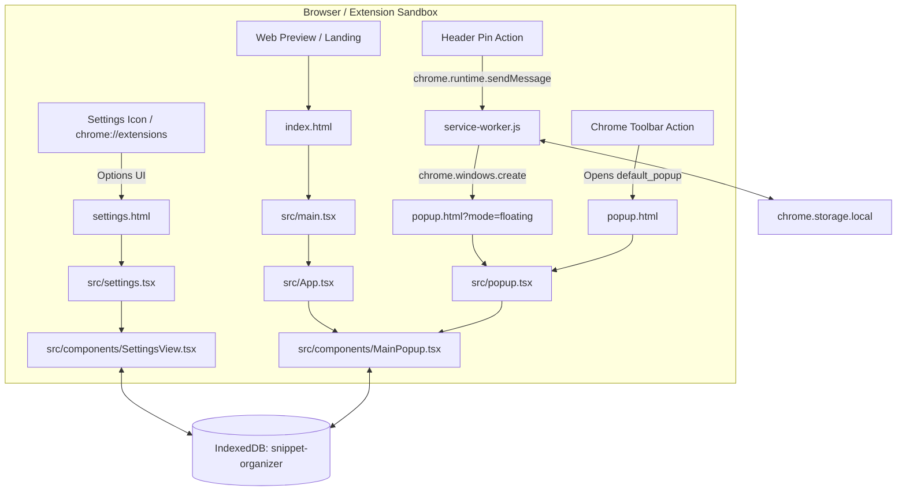

# Architecture — Snippet Organizer

**Snapshot Date: 2026-10-15** `[SOURCE-VERIFIED]`

This document describes the implemented runtime architecture, module boundaries, data persistence, and communication flow of the Snippet Organizer Chrome Extension.

---

## 1. System Execution Model & Entry Points

The application is structured as a multi-entry-point Single Page Application (SPA) built with Vite and packaged as a Chrome Manifest V3 extension `[SOURCE-VERIFIED]`.



### Entry Points Inventory `[SOURCE-VERIFIED]`

| Entry Point | HTML File | TypeScript Entry | Root React Component | Purpose |
|---|---|---|---|---|
| **Docked Popup** | `popup.html` | `src/popup.tsx` | `MainPopup` | Default extension popup opened from Chrome toolbar (fixed 480 × 600 px application viewport, shared with floating mode; raised 430 × 550 popup inset on an exact 25 px background ring; content-sized by Chrome, not user-resizable) |
| **Floating Window** | `popup.html?mode=floating` | `src/popup.tsx` | `MainPopup` | Detached standalone browser window created by service worker (same fixed 480 × 600 px content viewport and 25 px ring; outer window frame-compensated and size-locked by the service worker) |
| **Settings Page** | `settings.html` | `src/settings.tsx` | `SettingsView` | Dedicated options page opened in a full tab via `chrome.runtime.openOptionsPage()` |
| **Web Preview App** | `index.html` | `src/main.tsx` | `App` | Standalone browser preview for testing, demoing, and downloading the extension zip |
| **Background Worker** | N/A | `service-worker.js` | N/A (Service Worker) | Coordinates floating window lifecycle, prevents duplicate windows, tracks window ID |

---

## 2. Component Hierarchy & Module Responsibilities

### Primary Component Tree

```
src/components/MainPopup.tsx (Orchestrator)
├── Header.tsx (Logo, Pin/Unpin, + New Snippet, Settings Gear, Close)
├── SearchAndFilters.tsx (Debounced Search Input, Filter Tabs: All / Favorites, Category Dropdown)
├── SnippetCard.tsx (List item, Golden Favorite Star, Category Badge, Copy Button, Three-dot Menu)
├── Footer.tsx (Sync Status, Last Synced Time, Developer Attribution)
├── SnippetPreviewModal.tsx (Full Snippet Reader, Copy, Edit, Favorite Toggle)
├── SnippetEditorModal.tsx (Rich Text Editor, Toolbar, Category Picker, Duplicate, Delete)
└── SettingsModal.tsx (In-popup modal rendering SettingsView)
    └── SettingsView.tsx (General, Categories, Shortcuts, Backup & Data, Trash, About)
```

### Module Responsibilities `[SOURCE-VERIFIED]`

| File Path | Primary Responsibility | Key State Owned |
|---|---|---|
| `src/components/MainPopup.tsx` | Main orchestrator: coordinates search queries, active category, active filter, keyboard navigation, data fetching | `snippets`, `categories`, `searchQuery`, `activeFilter`, `selectedCategoryId`, `previewSnippetId`, `editorState` |
| `src/components/Header.tsx` | Branding, floating window detachment trigger, modal opening triggers | `isPinned` presentation state |
| `src/components/SearchAndFilters.tsx` | Search input with `Ctrl+K` shortcut indicator, filter tabs ("All", "Favorites"), Category picker overlay via React Portal | `isCategoryMenuOpen`, `dropdownPos` |
| `src/components/SnippetCard.tsx` | Renders individual snippet card, static golden star indicator, copy feedback animation, overflow three-dot menu | `isMenuOpen` |
| `src/components/SnippetEditorModal.tsx` | Content editing, rich-text formatting toolbar (`cleanHtmlFormatting`), new category creation palette, duplicate & delete actions | `title`, `content`, `categoryId`, `isFavorite`, `isCategoryMenuOpen` |
| `src/components/SnippetPreviewModal.tsx` | Read-only modal displaying rendered HTML snippet content with metadata and action triggers | `copied` feedback state |
| `src/components/SettingsView.tsx` | Comprehensive management view with 6 tabs: General, Categories, Shortcuts, Backup & Data, Trash, About | `activeTab`, `trashedSnippets`, `categories`, `preferences` |
| `src/db.ts` | Data access layer: IndexedDB initialization, seed data generation, CRUD operations, ranking algorithm, trash retention purging | IndexedDB connections, transaction handling |
| `src/types.ts` | Shared TypeScript domain interfaces and type definitions | `Snippet`, `Category`, `Preferences`, `BackupData`, `FilterType` |

---

## 3. Data Persistence & IndexedDB Schema

The application stores all primary user data in browser **IndexedDB** under the database name `snippet-organizer` (version `1`) `[SOURCE-VERIFIED]`.

### Object Stores & Indexes `[SOURCE-VERIFIED]`

#### 1. Store: `snippets` (keyPath: `id`)
Stores individual snippet records.
- `id` (string, UUID or `snip-X`)
- `title` (string)
- `content` (string, HTML formatted content)
- `categoryId` (string, foreign key referencing `categories.id`)
- `isFavorite` (boolean)
- `createdAt` (timestamp number)
- `updatedAt` (timestamp number)
- `lastUsedAt` (timestamp number | null)
- `deletedAt` (timestamp number | null — non-null indicates item is in Trash)
- `version` (number)
- **Indexes**:
  - `categoryId`: non-unique index for filtering by category
  - `isFavorite`: non-unique index for filtering favorites
  - `deletedAt`: non-unique index for separating active vs. trashed snippets
  - `lastUsedAt`: non-unique index for recent snippet sorting

#### 2. Store: `categories` (keyPath: `id`)
Stores snippet organization categories.
- `id` (string, e.g. `'default'`, `'shipping'`, `'billing'`, `'account'`)
- `name` (string)
- `color` (string, hex color code)

#### 3. Store: `preferences` (keyPath: `key`)
Stores application configuration.
- Stored as a single record under `key: 'user_preferences'`.
- Synchronously mirrored to `chrome.storage.local` when the extension API is available `[SOURCE-VERIFIED]`.

---

## 4. Search & Priority Ranking Engine

Search execution is implemented in `filterAndRankSnippets` in `src/db.ts` and debounced by 150ms in `MainPopup.tsx` `[SOURCE-VERIFIED]`.

### Ranking Algorithm & Strict Hierarchy `[SOURCE-VERIFIED]`
Matches are categorized and sorted strictly by field relevance:
1. **Tier 1: Title Match** (Highest priority)
   - Exact Title match: priority score `10`
   - Prefix Title match: priority score `11`
   - Substring Title match: priority score `12`
2. **Tier 2: Content Match** (Second priority)
   - Exact Content match: priority score `20`
   - Prefix Content match: priority score `21`
   - Substring Content match: priority score `22`
3. **Tier 3: Category Match** (Third priority)
   - Exact Category match: priority score `30`
   - Prefix Category match: priority score `31`
   - Substring Category match: priority score `32`

**Tie-Breaking Rule**: When two snippets have the same priority score, their original library order is strictly preserved `[SOURCE-VERIFIED]`. Snippets matching both Title and Content receive the higher Title score.

---

## 5. Background Service Worker & Window Coordination

The Manifest V3 background service worker (`service-worker.js`) manages the lifecycle of the detached floating window `[SOURCE-VERIFIED]`:

### Message Protocol

| Message Type | Direction | Payload | Behavior |
|---|---|---|---|
| `OPEN_FLOATING_WINDOW` | Popup -> SW | None | Sets `isFloatingMode: true`, calls `chrome.action.setPopup({ popup: '' })`, checks `floatingWindowId` and `floatingWindowPosition`. If window exists, focuses it; if not, calls `chrome.windows.create` with `width/height: compensatedOuterSize()` = `FIXED_WINDOW_WIDTH/HEIGHT (480/600) + calibrated frame delta`, `type: 'popup'` (content viewport = the fixed 480 × 600 layout shared with docked mode — UI-WINDOW-LOCK-01/02/03/04; `chrome.windows` sizes are OUTER dimensions including the browser frame, so the delta from `CALIBRATE_FLOATING_FRAME` is added), restores saved `left`/`top` if valid, and stores ID |
| `UNPIN_FLOATING_WINDOW` | Floating -> SW | `windowId?` | Explicitly unpins floating window: sets `isFloatingMode: false`, restores `chrome.action.setPopup({ popup: 'popup.html' })`, removes window via `chrome.windows.remove`, and clears `floatingWindowId` |
| `CLOSE_FLOATING_WINDOW` | Floating -> SW | `windowId?`, `reattach?` | Records latest window bounds to `floatingWindowPosition`, removes window via `chrome.windows.remove`, and clears `floatingWindowId`. If `reattach` is true, restores attached mode; otherwise preserves `isFloatingMode: true` |
| `SAVE_FLOATING_POSITION` | Floating -> SW | `{ position: { left, top } }` | Validates and persists floating window screen coordinates to `chrome.storage.local.floatingWindowPosition` |
| `GET_FLOATING_STATUS` | Any -> SW | None | Returns `{ isFloating: boolean, isFloatingMode: boolean, windowId: number | null, position: ... }` |
| `ping` | Any -> SW | None | Returns `{ ok: true, type: 'pong' }` for health checks |

Window movement is tracked in real time via `chrome.windows.onBoundsChanged` (debounced by 200ms) to ensure coordinates are persisted across browser sessions `[SOURCE-VERIFIED]`. External OS closure is monitored via `chrome.windows.onRemoved.addListener`, ensuring `floatingWindowId` is cleaned up automatically if the user closes the window with native OS controls while retaining `isFloatingMode: true` and the saved position for subsequent sessions `[SOURCE-VERIFIED]`. Subsequent toolbar clicks trigger `chrome.action.onClicked`, reopening the floating window directly at the saved screen position without reattaching `[SOURCE-VERIFIED]`.

---

## 6. Build, Packaging & Distribution Pipeline

1. **Compilation**: `vite build` bundles `index.html`, `popup.html`, and `settings.html` into `dist/` (multi-entry config in `vite.config.ts` rollup options).
2. **Static Assets**: Files in `public/` (such as `manifest.json`, `service-worker.js`, and `icons/`) are copied into `dist/`.
   - **Canonical favicon/icon source (FAVICON-PACK-01, 2026-10-17)**: `public/icons/` holds the supplied Snippet Organizer icon pack — `icon16.png`, `icon32.png`, `icon48.png`, `icon128.png` (the exact filenames referenced by `public/manifest.json` `action.default_icon` + `icons`), plus `icon-master-1024.png` (high-resolution master artwork) and `README.txt` (pack provenance). These supplied files are the **canonical source for all future favicon/extension-icon usage**: do not regenerate, redesign, or substitute the artwork — replace the whole pack only with an explicitly provided new pack. The three Vite entry pages (`index.html`, `popup.html`, `settings.html`) declare `<link rel="icon">` pointing at the 16/32/48 px variants (relative `icons/…` paths, valid in dev and in `dist/`).
3. **Zip Packaging**: `scripts/pack-extension.js` packages the `dist/` directory into:
   - `dist/snippet-organizer-extension.zip`
   - `public/snippet-organizer-extension.zip` (available for one-click download on the web landing page).
   - Environment note (2026-10-15 audit): `scripts/pack-extension.js` shells out to `python3`, which is absent in the current environment; the equivalent fallback is `npx vite build` followed by `Compress-Archive` of `dist/*` into `public/snippet-organizer-extension.zip`.

---

## 7. Styling Architecture `[SOURCE-VERIFIED]`

All visual styling is centralized in a **single CSS entry, `src/index.css`** (601 lines at the 2026-10-15 audit):

1. **Loading path**: `src/index.css` is imported by the TypeScript entries (`src/main.tsx`, `src/popup.tsx`, `src/settings.tsx`), so every extension surface (web demo, docked/floating popup, settings page) receives the identical stylesheet. There is no per-surface CSS isolation; all classes are global.
2. **Tailwind CSS v4**: `@import "tailwindcss";` (line 1) processed by `@tailwindcss/vite` (`vite.config.ts`). All design-system classes are declared **unlayered after the import**, so at equal specificity they win over Tailwind utility layers — a component-level `rounded-2xl` can be silently overridden by a class that sets `border-radius`.
3. **Locked Red Glass-Claymorphism system**: the current visual material (see `docs/design/DESIGN_SYSTEM.md` Sections 2–4 for values and component mapping). Key selectors: `.glass-app-bg`, `.glass-clay-surface`, `.clay-btn`/`.nm-primary-raised`, `.clay-decor`/`.nm-logo-raised`, `.glass-inset`/`.nm-static-inset-field`/`.nm-static-inset-editor`, plus scaled glass-clay variants (`nm-raised`, `nm-inset`, `nm-primary-inset`, `nm-icon-btn*`, `nm-static-inset-card*`, `nm-static-inset-section*`, `nm-dropdown-panel`, `nm-menu-item-*`, `nm-color-swatch*`).
4. **Class-name stability contract**: `nm-*` names are a preserved API across four visual eras. The class name does **not** imply the historical material — always check `src/index.css`. Restyling happens in the stylesheet, not by renaming classes in components.
5. **Where to change what**:
   - Global background, main surfaces, buttons, insets → selectors in `src/index.css` (locked values require user approval to change).
   - One-off component-local glass treatments → Tailwind arbitrary-value utilities inline in the component (e.g. sidebar `bg-white/25 backdrop-blur-sm` in `SettingsView.tsx`), tinted from the same red palette.
   - Rich-editor content semantics (links, lists, blockquote) → scoped `.rich-editor-content` / `[data-testid="editor-surface"]` rules at the bottom of `src/index.css`.
6. **HTML-level styling**: `popup.html` carries an inline `<style>` fixing `html, body { width: 480px; height: 600px }` — one fixed application viewport for both modes (docked action popup and floating window; UI-WINDOW-LOCK-01/02/03/04, supersedes all earlier 712 × 512 / 732 × 532 / 772 × 572 / 480 × 560 / 480 × 580 layouts) — plus `#root { width: 100%; height: 100% }` and a script adding a `floating` class when `?mode=floating`; the page `<body>` is `bg-transparent` — all theming comes from React-applied classes, not HTML. **Floating-window sizing (UI-WINDOW-LOCK-04)**: `chrome.windows.create/update` and `onBoundsChanged` use OUTER dimensions including the browser frame, while the page needs a 480 × 600 CONTENT viewport; the floating page therefore reports its measured frame delta once on load (`CALIBRATE_FLOATING_FRAME`: `outerWidth/Height − innerWidth/Height`, sanity-bounded 0–200 px), the service worker caches it (`storage.session`) and sizes/enforces the outer window at layout + delta via an exact two-way `onBoundsChanged` clamp (`chrome.windows` has no content-size API and no `resizable` option — soft lock, snap-back; first-ever open may snap once to the compensated size; delta is platform-dependent and unverifiable without a real Chrome host `[UNKNOWN]`). The `src/popup.tsx` background root carries `p-[25px]` so the raised `MainPopup` surface (`w-[430px] h-[550px]`) sits inset on a visible 25 px flat-background ring on all four sides; the snippet list is the only scrollable region (`flex-1 min-h-0 overflow-y-auto`), keeping the footer pinned inside the viewport.
7. **Constraints observed during audit**:
   - `backdrop-filter` blurs only what is behind an element; surfaces inside `.glass-clay-surface` stack translucent whites rather than blurring the red canvas again.
   - `.glass-inset input/textarea` are forced transparent/borderless so inner inputs never compete with the inset wrapper.
   - Duplicate locked-spec selectors (`.clay-btn`/`.clay-decor` vs `.nm-primary-raised`/`.nm-logo-raised`) are intentional grep-able references and must be kept in sync.

## 8. Google Drive Backup Architecture (GD-01–GD-08, 2026-10-18) `[SOURCE-VERIFIED]`

Optional, **explicit user-initiated** cloud backup into the user's own Drive `appDataFolder` (`drive.appdata` scope, `chrome.identity.getAuthToken`, user-owned OAuth client — D1/D2/D3). **No synchronization exists**: GD-06 closed `blocked` (data-contract §17 holds the unapproved change-log proposal); there is no sync engine, no background activity (D6), and no sync UI (GD-07 removed the fabricated footer status).

### Module map & data flow `[SOURCE-VERIFIED]`
- `src/gdrive/auth.ts` — `createAuthController`: config validation (`resolveOAuthConfig` over `runtime.getManifest`; placeholder client ID = `not-configured`), typed auth results (`authorized` / `not-configured` / `interaction-required` / `denied` / `error`), `signOut()` (clears the Chrome token cache only — the `AuthDeps` seam has no network capability, so sign-out structurally cannot touch cloud files; guarded by a GD-08 surface test).
- `src/gdrive/connection.ts` (PR-1, 2026-10-19; PR-1b) — `createConnectionProbe`: SILENT startup verification of the real connection state (config → persisted user-disconnect intent (`chrome.storage.local` `gdriveUserDisconnected` — while set, returns `disconnected` with zero auth/network calls; only an explicit Connect clears it) → non-interactive `getAuthToken` → Drive `about.get` with `fields=user(displayName,emailAddress,photoLink)`; `drive.appdata` is a documented `about.get` scope, so identity needs no extra permission). 401 → clear cache + one silent retry, still-failing ⇒ honest `disconnected`. Returns typed `DriveConnectionState` + in-memory-only identity; never prompts, never logs.
- `src/gdrive/types.ts` / `snapshot.ts` / `conflict.ts` — v2 snapshot schema, deterministic build/parse with digest integrity, quarantine-with-warning tolerance, v1 backup import migration; deterministic content hash (volatile fields excluded) and the conflict vocabulary (`add` / `unchanged` / `content-conflict` / `deletion-state-conflict`).
- `src/gdrive/gather.ts` — trash-inclusive, id-ordered local state gathering (pure readers).
- `src/gdrive/driveClient.ts` — Drive REST v3: multipart upload ≤ 5 MB / resumable above; `appProperties` carry `backupId`/`schemaVersion`/`displayName`; list (paginated, `appDataFolder`), `alt=media` download, permanent `files.delete`.
- `src/gdrive/backup.ts` — orchestrator: success only on Drive-confirmed file id; 401 → clear token + silent re-auth + retry-once; ambiguous timeout → reconcile by unique `backupId` before any retry; additive only (never overwrites/deletes). PR-1c: checks the persisted disconnect intent BEFORE authorize — while set, Create returns `failed{reason:'user-disconnected'}` with zero auth/reads/uploads.
- `src/gdrive/snapshotStore.ts` — `createDriveService`: metadata-first browse (newest-first, page cap), download validated by the GD-01 parser before use (raw fallback for unreadable files), cloud-only delete, shared 401 retry. PR-1c: `withAuthorizedClient` checks the persisted disconnect intent BEFORE any token lookup — browse/download/delete/restore-download return `user-disconnected` with ZERO auth/network calls while the flag is set (Disconnect never deletes remote data).
- `src/gdrive/restore.ts` + `db.applyRestoreWritePlan` — read-only preview → verified safety checkpoint (D7: without it, every write is blocked) → explicit confirmation → ONE atomic IndexedDB transaction → post-write count verification; injected failures roll back (no partial restore).
- UI surface: `SettingsView.tsx` → Backup & Data → "Google Drive Snapshots" card (connection row — PR-1: probe-backed state on mount with `checking`→`connected`/`disconnected`/`connection-error` + account identity (email/https avatar, cleared on Disconnect); Create block, list with Save/Restore/Delete, inline GD-05 preview panel). Popup footer (PR-1): attribution + a REAL-state "Google Drive connected / not connected" indicator from the same silent probe — still NO sync claims (GD-06/GD-07 hold). POPUP-REFRESH-01 (2026-10-19): a Refresh button beside the search field re-runs `MainPopup.loadData` (epoch-guarded) + the silent probe via the tested `src/popupRefresh.ts` orchestrator (single-flight; never clears the disconnect intent; never interactive; never mutates snapshots; turn 17: local reload and probe run CONCURRENTLY via `Promise.allSettled` so a hung Drive check never blocks/delays local refresh; content region fades + `aria-busy`, icon spins tinted brand-red, reduced-motion freezes to a static red indicator; footer flips to `checking` during every real re-probe). THIN-SCROLL-01 (turn 16: global + red; turn 17: + category tab row; turn 18: + All Category dropdown — root cause of the "classic scrollbar" defect was an undefined `no-scrollbar` no-op class): the shared `.nm-scrollbar` utility (index.css, both entry points import it; portals reach it — same document) with a token-based brand-red thumb (`--red-scrollbar-thumb/-hover` derived from `--red-brand`) is applied per scroll container on ALL popup pages — Main Popup list, category/filter tab row, All Category dropdown panel, editor/preview modal scrolls (3), Settings sidebar/content/snapshot/restore lists (4); remaining `no-scrollbar` uses in the editor toolbars are an unreported surface. Turn 17 also: Settings → Shortcuts rows restacked vertically (SHORTCUTS-VERTICAL-01) and the Footer's connected dot replaced by the official inline-SVG Google "G" (`GoogleLogo.tsx`; turn 19: superseded by the official Google Drive triangular logo `GoogleDriveLogo.tsx` — Drive-only integration; checking = subtle pulse; not-connected keeps the neutral dot — no sync claims).

### Verification status (GD-08 + PR-1) `[COMMAND-VERIFIED]` / `[UNKNOWN]`
- **136** module assertions across `tests/gdrive-{connection,auth,contract,backup,browse,restore}.test.ts` (14/22/27/26/19/28; PR-1 added the connection suite + driveClient reason tests) — stubbed deps, NOT live services; `npm.cmd run lint` exit 0; `npx.cmd vite build` exit 0 (pack step needs `python3`; documented fallback used — PR-1 rebuilt the zip with forward-slash entry names via .NET `ZipArchive` after `Compress-Archive` was found writing `assets\…` backslash entries; dist `manifest.json` verified byte-identical to source, zip root `manifest.json` verified).
- Live OAuth/Drive E2E: the user completed the Cloud setup (real client ID, Drive API, Test user) and attests **auth + snapshot create/list work live** (USER-ATTESTED; not agent-observed `[UNKNOWN]`). PR-1's restart-state/identity/error-rendering fixes still need the manual in-Chrome checklist (`reports/PR1-production-readiness-report.md`). Canonical task contracts: `docs/google-drive-integration/data-contract.md`.
